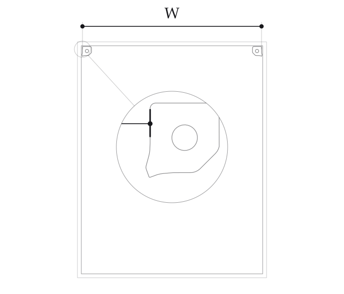
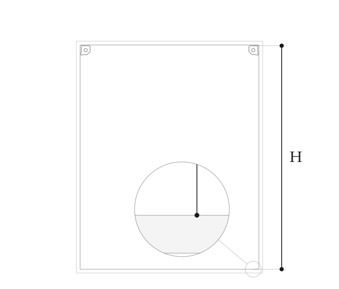
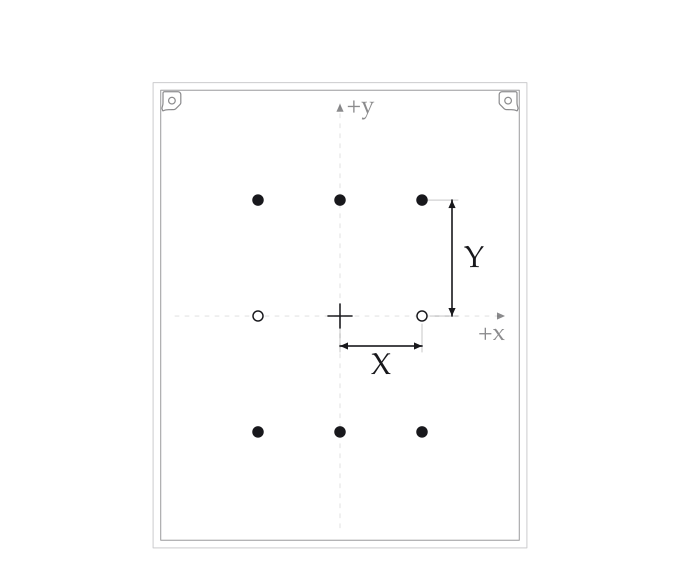

# Set up your plotter

Open **http://plotter.local** on the same network as your Pi. Use the matching
host and firmware from these repositories. The wizard checks firmware support
before starting. Machine calibration uses the local connection; the public
Home Assistant relay cannot verify the required controller responses.

## Setup wizard

Open **Setup wizard** from the menu. You can repeat it whenever you change the
machine geometry. You need two measurements, a center mark and a homing test.

Use the published motor covers at their original scale, seated on their centering
caps. The two covers must be level with one another. The guides use their exposed
**top seams**, including the cover’s draft angle. If you change the covers or motor
mounts, these measurement offsets no longer apply.

1. **Width:** measure horizontally between the outside top seams of the two upper
   motor covers, above the switch bulges. Enter the full measurement in mm or inches.

   

2. **Height:** measure vertically from a cover’s top seam to the inner top edge
   of the bottom rail. Keep the tape straight and enter the full measurement.

   

3. **Center:** the wizard draws half of each reading on the machine. Mark that
   point. Use a fine cross. Remove the pen and
   turn motor power off before positioning the center of the pen hole on the
   cross. Power on without moving it, then connect.
4. **Home and return:** watch the machine find both switches and return slowly.
   Confirm that the pen-hole center is back on the cross with no belt slip, then
   choose **Save**. If it misses, check the measurements, alignment and
   mechanics before repeating setup. Stay by the power switch during this test.

The wizard saves the geometry on the Pi and controller and verifies it by
reloading the controller’s saved values. Homing supplies the belt reference;
it cannot measure your paper or discover the board dimensions by itself.

After a power cycle, use **Home** to restore the position reference before
plotting. Keep the center mark available so you can check the return.

## Advanced calibration

The saved setup is enough to begin a small test plot. Advanced calibration is an
optional accuracy check and fit preview; it currently does **not** install a
correction. Use it to establish whether your machine needs further adjustment.

1. Home, check the return to your center mark, and remove the pen. Open **Advanced
   calibration**, confirm the paths are clear, and prepare the measurement points.
2. Choose **Move to this point**. When it stops, mark the center of the pen hole.
3. Choose **Marked, move aside**. The gondola moves 60 mm outward: left
   for left-side points and right for right-side points. At vertical points,
   either side can clear the mark. If there is insufficient room, measure in place.
4. Measure between the original center cross and the new cross. Enter horizontal
   X and vertical Y separately in millimeters: right/up are positive, left/down
   are negative. Do not measure the diagonal or the parked gondola.
5. Repeat for all eight points. Download the measurements, then choose
   **Compare accuracy and fit**. Six points inform the fit; two check it independently.

Use fine crosses and read their centers. A fixed tape and a square or level help
separate the horizontal and vertical distances. Lift and replace the measuring
tool to repeat a reading. If rereads differ by several millimeters, improve the
measurement before fitting. Keep the original readings; do not choose whichever
number happens to be closest to the target.

Do not home, manually move the gondola, disconnect or power-cycle during a set.
The interface preserves each marked point’s motor capture separately from its
move-aside position. If the reference changes or a move has an uncertain result,
start a fresh set after checking the machine. Downloaded data remain available
for review; reloading the page never resumes motion automatically.

Compare the **independent checks** for both geometries. A lower error on the
fitting points alone is not enough. If the independent checks get worse, keep
the saved setup. A passing preview describes agreement with your measurements,
not certified accuracy or a correction already applied to the machine.

## First drawing

Check the paper position and proposed drawing area with the pen removed. Start
near the center with a small square or grid. Set the pen to make light contact,
then draw and measure its width, height and diagonals. Expand the test area only
after checking clearance and the smaller drawing. A successful home return
establishes the reference; the drawing checks accuracy under actual pen contact.

For the geometry, firmware checks and current limits, see the
[implementation notes](README.md) and [guided measurement notes](guided-accuracy.md).
